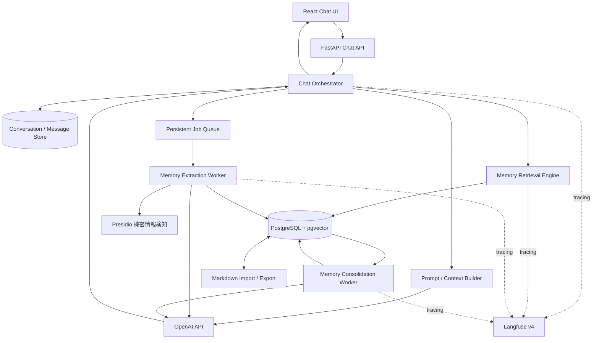
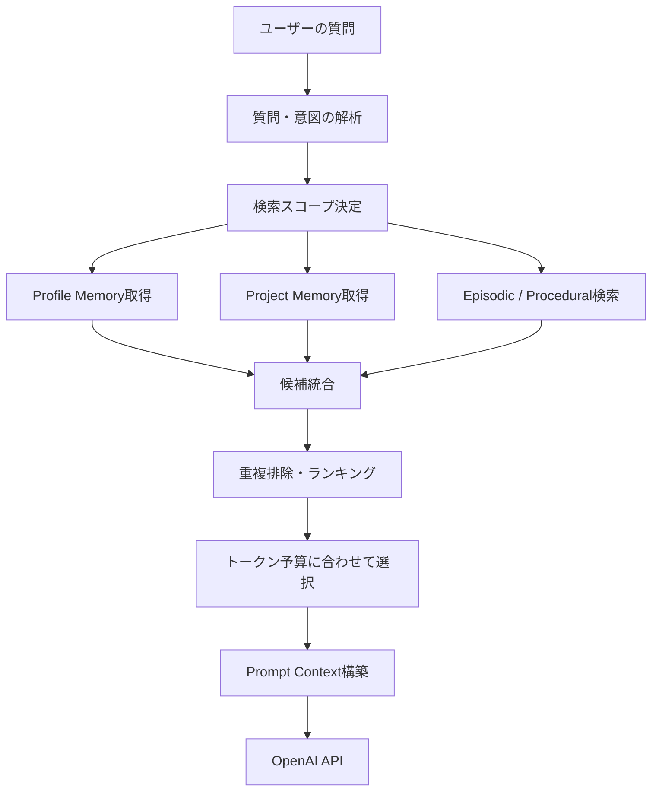

# Personal Memory System 設計案

-   文書種別: PoC向け基本設計案
-   対象アプリ: 独自AI Chat App
-   作成日: 2026-11-09
-   改訂: 2026-11-09 個人情報の検知を対象外とし、機密情報検知の方針を現行実装に合わせた。未確定事項を確定し（19章）、既存実装との対応を追加した（2.2）
-   ステータス: 設計確定（PoC）。実装は未着手

------------------------------------------------------------------------

## 1. 目的と設計方針

本設計は、OpenAI APIを利用する独自AI Chat
Appに、ChatGPT側のMemory機能に依存しない長期記憶機能を追加するものである。

目標は、会話履歴を単に検索できるようにすることではなく、会話からユーザーの好み、継続中のプロジェクト、過去の判断、作業手順などを抽出・整理し、後続の会話で適切に再利用できるようにすることである。

### 1.1 基本方針

1.  **自前DBを記憶の正本とする。** OpenAI
    APIの会話状態管理機能は利用してもよいが、長期記憶の唯一の保存先にはしない。
2.  **会話原文と抽出記憶を分離する。**
    原文は監査・再処理のために保持し、検索時には要約・構造化記憶を中心に利用する。
3.  **記憶の出典を追跡可能にする。**
    すべての記憶に元メッセージや抽出ジョブへの参照を持たせる。
4.  **記憶の作成と利用を分離する。**
    回答時は既存記憶を検索し、会話後に非同期で記憶を抽出・更新する。
5.  **記憶の訂正・削除をユーザーが制御できる。**
6.  **AIの推測とユーザーの明示的な発言を区別する。**
7.  **記憶データは信頼できるシステム指示ではなく、参照データとして扱う。**

### 1.2 「使えば使うほど賢くなる」の定義

本PoCでは、モデル自体の重みを再学習することではなく、次の改善を指す。

-   ユーザーの明示的な好みや制約を再利用する。
-   過去の会話・判断・設計理由を参照する。
-   継続中のプロジェクトの状態を把握する。
-   ユーザーの訂正を反映し、誤った記憶を修正する。
-   繰り返し確認された作業上の傾向を、再利用可能なルール候補にする。

------------------------------------------------------------------------

## 2. 現行システム構成

| 区分 | 技術 |
| --- | --- |
| フロントエンド | React 19 + TypeScript + Vite 8 + Tailwind v4 + shadcn/ui |
| バックエンド | FastAPI + SQLAlchemy 2 (async) + Alembic + OpenAI Python SDK |
| アプリDB | PostgreSQL 17 + pgvector 0.8.6 + pg_trgm |
| PDF解析・表示 | PyMuPDF 1.28（worker）、PDF.js 6.3 |
| 観測 | Langfuse v4（別Composeプロジェクト） |
| 機密情報検知 | Microsoft Presidio Analyzer 2.2.362 |
| 実行環境 | Windows + Docker Desktop（コンテナはLinux） |

### 2.1 追加する論理コンポーネント

-   Memory Retrieval Engine
-   Memory Extraction Worker
-   Memory Consolidation Worker
-   Memory Management API
-   Markdown Export / Import Service
-   Memory Management UI

既存FastAPIアプリと同じリポジトリ・Composeプロジェクト内に配置する。WorkerはWeb
APIプロセスから分離する。

### 2.2 既存実装との対応

| 対象 | 現状 | 本設計での扱い |
| --- | --- | --- |
| 適用範囲 | チャットと資料Q&Aがある | 長期記憶はチャットだけに適用する。資料Q&Aは登録資料だけを根拠にするため、記憶を検索も抽出もしない |
| `conversations` | `user_id` とプロジェクトの情報がない | `user_id`、`project_id`、`memory_enabled` を追加する（6.9） |
| `messages` | 原文を保存済み。再実行のため1ターンに複数の回答がある | 既存を正本にする。AI発言の文脈には `turns.adopted_message_id` の回答だけを使う |
| 会話の削除 | `hidden_at` による非表示のみ | 非表示は記憶に影響しない（14.4） |
| ジョブ | `jobs` テーブルと独立Worker | 既存の `jobs` を使い、`memory_jobs` は作らない（12章） |
| 機密情報検知 | `guard_secrets`（検知したらブロック、fail-closed） | Memory処理にも適用する（14.1） |
| システム指示 | `backend/prompts/` のファイルで管理 | AIの振る舞いは引き続きファイルで管理する。記憶からは変更しない |
| 利用上限・料金 | `llm_calls` を集計 | Memory処理のAPI呼び出しも `llm_calls` に記録し、上限に含める |
| API | `/api/v1/...`、Cookie認証、`X-OQA-Request` ヘッダー | 同じ規約に合わせる（11章） |

------------------------------------------------------------------------

## 3. 全体アーキテクチャ



### 3.1 処理の分離

**回答時の同期処理**

1.  ユーザー認証・権限確認
2.  入力の機密情報を検知（検知したら送信を中止）
3.  会話メッセージを保存
4.  現在の会話コンテキストを取得
5.  ユーザー・プロジェクト・関連エピソード記憶を検索（記憶が有効な場合のみ）
6.  検索結果をランキング・絞り込み
7.  Prompt Contextを構築
8.  OpenAI APIを呼び出す
9.  応答と、使用した記憶のIDを保存して返却
10. 記憶抽出ジョブを登録（記憶が有効な場合のみ。7.7参照）

**会話後の非同期処理**

1.  対象会話・メッセージを読み込む
2.  外部モデルへ送る入力の機密情報を検知（検知したら抽出を中止）
3.  保存対象情報を抽出
4.  抽出候補の機密情報を検知（検知した候補は破棄）
5.  既存記憶との重複・矛盾を検索
6.  新規作成・更新・旧情報の失効候補を決定
7.  記憶と出典を保存
8.  Embeddingを生成・保存
9.  必要に応じてMarkdown出力を更新
10. 処理結果を記録

------------------------------------------------------------------------

## 4. 記憶モデル

記憶は用途に応じて分類する。分類は排他的にしすぎず、`memory_type` と
`category` の組み合わせで表現する。

| 種別 | 説明 | 例 |
| --- | --- | --- |
| Profile / Semantic | 比較的長期間有効なユーザー情報 | 開発言語、回答形式の好み |
| Episodic | 過去の会話・出来事・判断 | 以前の設計相談、問題発生と解決 |
| Project | プロジェクト固有の状態・仕様 | 技術構成、決定事項、未解決課題 |
| Procedural | 再利用可能な作業手順・ルール | 設計時の確認手順、レビュー方針 |

### 4.1 Profile Memory

-   ユーザーが明示した情報を優先する。
-   一時的な情報と長期的な好みを区別する。
-   変更された情報は過去の値を履歴として残す。
-   機微情報は原則として記憶対象外とする。抽出時の指示で扱い、自動検知はしない（14.1参照）。

### 4.2 Episodic Memory

-   会話原文は `messages` に保存する。
-   エピソード記憶には要約、日時、関係するプロジェクト、重要な発言への参照を保存する。
-   詳細が必要な場合は元メッセージを再取得する。
-   要約だけを原本にしない。

### 4.3 Project Memory

会話とプロジェクトの紐づけは、利用者が会話ごとに手動で選択する。
未設定の会話からはProject Memoryを作らず、検索の対象にもしない。

プロジェクトごとに次の情報を管理する。

-   概要・目的
-   現在の技術構成
-   決定事項と選定理由
-   不採用案と理由
-   仕様変更履歴
-   未解決課題
-   次のアクション
-   関連会話・資料

### 4.4 Procedural Memory

-   繰り返し有効だった作業方法を候補として抽出する。
-   1回の反応だけで一般ルールにしない。
-   出典によらず常に候補（candidate）として作成し、ユーザーの承認後にだけ有効にする。
-   明示的なユーザー指示、複数回の観測、ユーザー承認を区別する。
-   危険な操作やセキュリティ制約を、単なる好みとして弱めない。

------------------------------------------------------------------------

## 5. Markdown外部記憶

### 5.1 目的

Markdownは、人間が記憶内容を確認・編集し、Gitで差分管理するための形式とする。検索・権限管理・履歴管理の正本はPostgreSQLとする。

DBとMarkdownを独立した正本にすると不整合が生じるため、**DBを正本、Markdownを編集・閲覧・エクスポート形式**とする。

### 5.2 ディレクトリ案

```text
memory/
├── AGENTS.md
├── USER.md
├── preferences.md
├── projects/
│   ├── ai-chat-app/
│   │   ├── overview.md
│   │   ├── architecture.md
│   │   ├── decisions.md
│   │   └── tasks.md
│   └── other-project/
│       └── overview.md
├── procedures/
│   ├── system-design.md
│   ├── code-review.md
│   └── security.md
└── archive/
    └── 2026/
```

### 5.3 ファイルの役割

| ファイル | 内容 |
| --- | --- |
| `AGENTS.md` | 記憶の利用ルールの説明（参照用。Importしない） |
| `USER.md` | ユーザーの基本プロフィール |
| `preferences.md` | 回答・開発に関する好み |
| `projects/*` | プロジェクト固有の情報 |
| `procedures/*` | 再利用可能な作業手順 |
| `archive/*` | 古い情報・過去のスナップショット |

### 5.4 同期ルール

-   DBからMarkdownへの出力を基本とする。
-   Markdownの編集をDBに取り込む場合は、インポート処理を明示的に実行する。
-   インポート時は差分を検出し、変更者・変更日時・対象記憶を記録する。
-   PoCではGit同期を行わない。ExportはZIPのダウンロードとする。
-   Export先をアプリのリポジトリ配下にしない。このリポジトリは公開されている。
-   将来Git同期を行う場合、個人情報はマスキングされないため、同期先は非公開リポジトリに限る。
-   AIの基本的な振る舞いは `backend/prompts/` で管理し、Markdownから変更しない。
-   Markdown内の命令文をシステム指示として無条件に採用しない。

------------------------------------------------------------------------

## 6. データベース設計

以下は初期設計案である。既存のユーザー・会話・メッセージテーブルがある場合は重複作成せず、既存スキーマに合わせる。

### 6.1 テーブル一覧

| テーブル | 区分 | 用途 |
| --- | --- | --- |
| `users` | 既存・列追加 | 記憶機能全体のON/OFF（6.9） |
| `conversations` | 既存・列追加 | 会話セッション（6.9） |
| `messages` | 既存 | ユーザー・AIの発言原文 |
| `jobs` | 既存・列追加 | 抽出・統合ジョブ（12章） |
| `projects` | 新規 | プロジェクト（6.8） |
| `memory_items` | 新規 | 抽出した記憶 |
| `memory_embeddings` | 新規 | 記憶Embedding |
| `memory_sources` | 新規 | 記憶の出典メッセージ |
| `memory_relations` | 新規 | 記憶間の関連 |
| `memory_versions` | 新規 | 記憶の変更履歴 |
| `memory_documents` | 新規 | Markdown文書の管理情報 |
| `memory_usages` | 新規 | 回答に使用した記憶（6.10） |

### 6.2 memory_items

| カラム | 型の例 | 説明 |
| --- | --- | --- |
| `id` | UUID | 主キー |
| `user_id` | UUID | 所有ユーザー |
| `project_id` | UUID NULL | 関連プロジェクト |
| `memory_type` | VARCHAR | semantic / episodic / project / procedural |
| `category` | VARCHAR | preference / decision / fact / task等 |
| `content` | TEXT | 記憶本文 |
| `summary` | TEXT | 検索・表示用要約 |
| `importance` | REAL | 重要度 |
| `confidence` | REAL | 信頼度 |
| `source_type` | VARCHAR | explicit / inferred / user_edited / import |
| `status` | VARCHAR | candidate / active / superseded / deleted |
| `valid_from` | TIMESTAMPTZ | 有効開始 |
| `valid_until` | TIMESTAMPTZ NULL | 有効終了 |
| `created_at` | TIMESTAMPTZ | 作成日時 |
| `updated_at` | TIMESTAMPTZ | 更新日時 |

`importance` と `confidence`
は0〜1の範囲を想定する。アプリケーション層でも範囲検証を行う。

### 6.3 memory_embeddings

| カラム | 型の例 | 説明 |
| --- | --- | --- |
| `memory_id` | UUID | memory_itemsへの参照 |
| `embedding` | VECTOR | Embedding |
| `embedding_model` | VARCHAR | モデル名・バージョン |
| `created_at` | TIMESTAMPTZ | 作成日時 |

Embeddingモデルは資料Q&Aと同じ `text-embedding-3-small`（1536次元）とする。
主キーは `(memory_id, embedding_model)` とし、検索時は `embedding_model` で絞る。
モデルを変更する場合は全記憶を再Embeddingする。

### 6.4 memory_sources

| カラム | 型の例 | 説明 |
| --- | --- | --- |
| `id` | UUID | 主キー |
| `memory_id` | UUID | 対象記憶 |
| `message_id` | UUID | 出典メッセージ |
| `source_role` | VARCHAR | user のみ（CHECK制約） |
| `evidence_excerpt` | TEXT NULL | 必要最小限の根拠抜粋 |
| `created_at` | TIMESTAMPTZ | 登録日時 |

1つの記憶が複数の発言から導かれる場合に対応する。
`(memory_id, message_id)` を一意にする。
根拠にできるのはユーザーの発言だけとする。
AIの発言は文脈として読むが、記憶の根拠にしない。

### 6.5 memory_relations

| カラム | 型の例 | 説明 |
| --- | --- | --- |
| `id` | UUID | 主キー |
| `from_memory_id` | UUID | 起点記憶 |
| `to_memory_id` | UUID | 関連記憶 |
| `relation_type` | VARCHAR | supports / contradicts / related_to / supersedes |
| `weight` | REAL | 関連度 |
| `created_at` | TIMESTAMPTZ | 登録日時 |

### 6.6 memory_versions

| カラム | 型の例 | 説明 |
| --- | --- | --- |
| `id` | UUID | 主キー |
| `memory_id` | UUID | 記憶ID |
| `version_no` | INTEGER | バージョン |
| `content_snapshot` | JSONB | 変更前後の内容 |
| `change_reason` | TEXT | 変更理由 |
| `changed_by` | VARCHAR | user / ai / system |
| `created_at` | TIMESTAMPTZ | 変更日時 |

削除済み記憶の履歴を無期限に残すかどうかは、プライバシー要件に合わせて決める。完全削除要求では履歴・バックアップ・Embeddingも対象範囲を明確にする。

### 6.7 インデックス方針

-   `memory_items(user_id, status, memory_type)` の複合インデックス
-   `memory_items(project_id, status)` のインデックス
-   `memory_items(valid_until)` のインデックス
-   `memory_sources(message_id)` のインデックス
-   `memory_relations(from_memory_id)` と
    `memory_relations(to_memory_id)` のインデックス
-   `content` / `summary` に `pg_trgm` のGINインデックス
-   `memory_embeddings.embedding` はPoCでは索引なしの完全探索とする

PostgreSQLの標準の全文検索は日本語を分かち書きしないため使わない。
ベクトルの索引（HNSW）は、1ユーザーの記憶件数が増えて検索時間の目標を超えたら導入する。

### 6.8 projects

| カラム | 型の例 | 説明 |
| --- | --- | --- |
| `id` | UUID | 主キー |
| `user_id` | UUID | 所有ユーザー |
| `name` | VARCHAR | プロジェクト名。ユーザー内で一意 |
| `description` | TEXT NULL | 概要 |
| `archived_at` | TIMESTAMPTZ NULL | アーカイブ日時 |
| `created_at` | TIMESTAMPTZ | 作成日時 |

### 6.9 既存テーブルへの追加

| テーブル | カラム | 型の例 | 説明 |
| --- | --- | --- | --- |
| `users` | `memory_enabled` | BOOLEAN | 記憶機能全体のON/OFF。既定はtrue |
| `conversations` | `user_id` | UUID | 所有ユーザー。既存の行は現在の唯一のユーザーで埋める |
| `conversations` | `project_id` | UUID NULL | 手動で選択したプロジェクト |
| `conversations` | `memory_enabled` | BOOLEAN | この会話で記憶を使うか。既定はtrue |
| `conversations` | `memory_extracted_through` | INTEGER | 抽出済みの最後の `turns.seq`（7.7） |
| `jobs` | `run_after` | TIMESTAMPTZ NULL | この時刻まで実行しない（7.7） |

### 6.10 memory_usages

| カラム | 型の例 | 説明 |
| --- | --- | --- |
| `run_id` | UUID | 回答の実行 |
| `memory_id` | UUID | 使用した記憶 |
| `rank` | INTEGER | 採用順位 |
| `score` | REAL | ランキングの得点 |

主キーは `(run_id, memory_id)` とする。
記憶の内容が後で変わっても、`memory_versions` と合わせて回答時点の内容を再現できる。

------------------------------------------------------------------------

## 7. 記憶抽出・更新処理

### 7.1 抽出対象

-   明示的なユーザー設定・好み
-   長期的に有効なプロフィール情報
-   プロジェクトの仕様・決定・進捗
-   過去の問題と解決方法
-   繰り返し確認された作業パターン
-   後続の会話で役立つ重要な出来事

根拠にできるのはユーザーの発言だけとする。AIの回答とWeb検索の結果だけに現れる情報は抽出しない。

### 7.2 原則として保存しない情報

-   パスワード、APIキー、アクセストークン、秘密鍵
-   一時的で再利用価値の低い発言
-   根拠のない推測
-   不要な機微情報
-   プロンプトインジェクション等の命令文を、行動ルールとして抽出したもの

### 7.3 抽出アクション

| アクション | 意味 |
| --- | --- |
| `create` | 新しい記憶を作成 |
| `update` | 既存記憶を更新 |
| `supersede` | 古い記憶を新しい記憶で置き換える |
| `candidate` | 承認・追加確認が必要な候補 |
| `ignore` | 保存しない |

`delete`
はAIの自動判断で即時実行させず、ユーザー操作または明確なポリシーに基づく削除処理として扱う。

記憶の状態は次のルールでサーバーが決める。LLMの指定をそのまま採用しない。

| 条件 | 状態 |
| --- | --- |
| `source_type` が explicit、かつ `confidence` が0.8以上、かつ既存記憶と矛盾しない | active |
| `source_type` が inferred | candidate |
| `memory_type` が procedural | candidate（条件によらない） |
| `confidence` が0.8未満、または既存記憶と矛盾する | candidate |

### 7.4 Structured Outputの例

```json
{
  "memories": [
    {
      "memory_type": "semantic",
      "category": "development_preference",
      "content": "バックエンド開発ではPythonとFastAPIを希望する",
      "summary": "Python / FastAPIを開発で希望",
      "importance": 0.8,
      "confidence": 0.99,
      "source_type": "explicit",
      "action": "create",
      "project_reference": null,
      "evidence_message_id": "M3",
      "evidence": "今後の開発ではPythonとFastAPIを使いたい"
    }
  ]
}
```

実際のJSON
Schemaでは、列挙値、必須項目、数値範囲、文字数上限を指定する。モデルの出力をそのままDBに登録せず、Pydanticで再検証する。

発言には実行内だけのID（M1、M2…）を振り、LLMにはそのIDで出典を返させる。サーバーは次を検証する。

-   `evidence_message_id` が提示した発言のIDである。
-   その発言の `role` が user である。
-   `evidence` の文字列がその発言の原文に含まれる。

検証に通らない候補は保存しない。`memory_sources.evidence_excerpt` には原文から取り出した文字列を保存する。

### 7.5 既存記憶との照合

1.  同一ユーザー・同一カテゴリ・関連プロジェクトで候補を絞る。
2.  キーワード検索とベクトル検索で類似記憶を取得する。
3.  新旧の内容、出典、時点、適用範囲を比較する。
4.  重複なら統合候補、矛盾なら競合候補として扱う。
5.  明示的な新情報で更新する場合も、過去の記憶は履歴として保持する。
6.  自動更新の確信が低い場合は候補状態にする。

### 7.6 時間軸の管理

例：

-   過去：Flaskを利用していた。
-   現在：既存サービスはFlaskで運用している。
-   方針：新規開発ではFastAPIを希望している。

これらは矛盾とは限らない。対象プロジェクト、適用範囲、有効期間を区別して保存する。

### 7.7 実行タイミングと冪等性

チャットには「会話の終了」がないため、次のように扱う。

1.  ターンが完了するたびに、その会話の抽出ジョブを登録する。
2.  実行待ちのジョブは会話ごとに1件とする。既にあれば `run_after` を延ばす。
3.  `run_after` の初期値は最後のターンの完了から10分後とする。
4.  Workerは `memory_extracted_through` より後のターンだけを処理する。
5.  処理が成功したら、記憶の保存と同じトランザクションで `memory_extracted_through` を進める。

ジョブが再実行されても、処理済みのターンは対象にならない。
抽出の直前に `memory_enabled` を再確認し、無効なら何もせず終了する。

抽出モデルは設定 `MEMORY_EXTRACTION_MODEL` で指定する。初期値は `gpt-5.6-luna` とし、17章の評価で見直す。

------------------------------------------------------------------------

## 8. Memory Consolidation

会話の増加に伴う重複・矛盾・陳腐化を整理する非同期処理を設ける。

### 8.1 処理内容

1.  類似記憶のグルーピング
2.  重複候補の検出
3.  矛盾候補の検出
4.  内容の統合案作成
5.  有効期間・状態の更新案作成
6.  バージョン履歴の保存
7.  Embeddingの再生成
8.  処理結果の監査ログ記録

### 8.2 実行タイミング

-   会話終了後：小規模な抽出・重複チェック
-   定期実行：蓄積した記憶の統合・整理
-   ユーザー操作時：明示的な訂正・統合・削除

初期PoCでは、会話後の抽出と定期的な統合を分ける。統合処理を回答リクエストの同期パスに入れない。

------------------------------------------------------------------------

## 9. Memory Retrieval

### 9.1 検索フロー



### 9.2 ハイブリッド検索

| 検索方式 | 主な用途 |
| --- | --- |
| SQL条件検索 | user_id、project_id、カテゴリ、状態、期間 |
| pg_trgm | キーワード・用語・表記揺れ |
| pgvector | 意味的類似検索 |

検索は必ず `user_id`
でスコープを制限する。プロジェクト単位の検索では、そのユーザーがアクセスできるプロジェクトだけを対象とする。

### 9.3 初期ランキング案

```python
score = (
    semantic_similarity * 0.40
    + keyword_similarity * 0.20
    + importance * 0.15
    + recency * 0.10
    + confidence * 0.15
)
```

これは初期仮説であり、固定仕様ではない。検索ログと評価データを使って調整する。
`semantic_similarity` と `keyword_similarity` は尺度が異なるため、0〜1に正規化してから使う。

注意点：

-   古い設計判断や重要なプロフィールは、古いという理由だけで除外しない。
-   明示的な事実と推測を区別する。
-   失効・削除済み記憶は通常検索から除外する。
-   同じ内容の記憶を重複してプロンプトに入れない。
-   検索結果がない場合、記憶を推測で補わない。

### 9.4 Reranking

初期段階ではスコアリングのみでもよい。検索品質が不足した場合に、候補記憶と質問の関連性をOpenAIモデル等で再評価するRerankerを追加する。

Rerankingは追加レイテンシー・トークン費用が発生するため、必要性を計測して導入する。

------------------------------------------------------------------------

## 10. Prompt Context Builder

検索した記憶をすべて投入せず、種類と重要度に応じてコンテキストを構成する。

### 10.1 推奨構成

```text
[SYSTEM INSTRUCTIONS]
AIの役割、制約、記憶の扱い方

[USER PROFILE]
長期的なプロフィール・好み

[PROJECT MEMORY]
今回の質問に関連するプロジェクトの現在状態

[RELEVANT EPISODIC MEMORY]
過去の関連会話・判断・出来事

[PROCEDURAL MEMORY]
今回のタスクに適用できる作業ルール

[CURRENT CONVERSATION]
現在の会話履歴
```

### 10.2 コンテキスト構築ルール

-   記憶ごとに種類・出典・信頼度を保持する。
-   記憶は参照データとして明示する。
-   記憶内の命令文をシステム指示として扱わない。
-   トークン予算を設定し、重要度順に選択する。
-   回答に使用した記憶IDをログに残す。
-   検索できなかった情報について、過去に話したと断定しない。
-   記憶は `instructions` に入れず、`input` 側に参照データとして渡す。
-   記憶に使うトークンの上限は初期値2,000とする。既存の文脈の上限（60,000字）の内側に収める。
-   質問のEmbeddingは、機密情報の検知を通過してから生成する。
-   記憶の検索に失敗しても、記憶なしで回答を続ける。失敗はログとLangfuseに記録する。

------------------------------------------------------------------------

## 11. API設計

既存のAPI規約に合わせる。すべてログイン必須とし、更新系には `X-OQA-Request` ヘッダーを必須とする。

| Method | Endpoint | 用途 |
| --- | --- | --- |
| GET | `/api/v1/memories` | 記憶一覧 |
| GET | `/api/v1/memories/{id}` | 記憶詳細 |
| PATCH | `/api/v1/memories/{id}` | 記憶編集 |
| DELETE | `/api/v1/memories/{id}` | 記憶削除 |
| POST | `/api/v1/memories/search` | 記憶検索 |
| POST | `/api/v1/memories/{id}/confirm` | 記憶候補の承認 |
| GET | `/api/v1/memories/{id}/history` | 記憶変更履歴 |
| GET・POST | `/api/v1/projects` | プロジェクトの一覧・作成 |
| PATCH | `/api/v1/projects/{id}` | プロジェクトの編集・アーカイブ |
| GET | `/api/v1/projects/{id}/memories` | プロジェクト記憶一覧 |
| PATCH | `/api/v1/conversations/{id}/memory` | 会話のプロジェクトと記憶ON/OFFの設定 |
| GET・PATCH | `/api/v1/memory-settings` | 記憶機能全体のON/OFF |
| POST | `/api/v1/memory-documents/export` | Markdown出力 |
| POST | `/api/v1/memory-documents/import` | Markdown取込 |

`user_id` はリクエストで受け取らず、認証済みのユーザーから決める。

### 11.1 検索APIのリクエスト例

```json
{
  "query": "以前のLangfuseの構成と選定理由",
  "memory_types": ["project", "episodic"],
  "project_id": "00000000-0000-0000-0000-000000000000",
  "limit": 10
}
```

### 11.2 記憶の編集・削除

-   編集時は変更前後を履歴に保存する。
-   削除時は通常検索から即時除外する。
-   Embedding、関連情報、キャッシュ、エクスポートデータの削除方針を定義する。
-   完全削除と論理削除を区別する。
-   ユーザー単位のデータ削除を確実に実施できるようにする。

------------------------------------------------------------------------

## 12. Worker・ジョブキュー

### 12.1 構成

既存の `jobs` テーブルを使う。Redisや `BackgroundTasks` は使わない。

-   ジョブの種類に `memory_extract` と `memory_consolidate` を追加する。
-   Memory用のWorkerを、PDF解析のWorkerとは別のComposeサービスにする。
    長いPDF解析に記憶の抽出が待たされないようにするため。
-   ジョブの取得は `kind` で絞り、`run_after` が過ぎたものだけを対象にする。
-   会話ごとの実行待ちを1件にするため、`kind` と会話IDに部分一意インデックスを設ける。
-   失敗は最大3回まで再試行し、それを超えたら `failed` のまま残す。

### 12.2 ジョブの要件

-   冪等性：同じ会話を複数回処理しても重複記憶を作らない。
-   再試行：一時的なAPIエラーに対応する。
-   失敗管理：一定回数失敗したジョブを隔離する。
-   排他制御：同一記憶の同時更新を防止する。
-   監査：入力、処理結果、モデル、所要時間を追跡する。
-   レート制御：OpenAI APIの利用上限に対応する。

------------------------------------------------------------------------

## 13. Langfuseによる観測

Langfuse
v4で、Chat処理とMemory処理を同一Traceまたは関連Traceとして追跡する。

### 13.1 記録対象

| 処理 | 計測項目 |
| --- | --- |
| Memory Retrieval | 検索時間、候補数、採用数 |
| Embedding | モデル、トークン数、時間 |
| Extraction | 入力・出力トークン、処理時間、抽出件数 |
| Consolidation | 統合候補数、更新件数、処理時間 |
| Reranking | 候補数、処理時間、採用結果 |
| Chat Completion | 入出力トークン、応答時間、モデル |
| Prompt Builder | 記憶投入数、コンテキストトークン数 |

### 13.2 評価指標

-   Memory Retrieval Hit Rate
-   Retrieval Precision / Recall（評価データセットを用いる）
-   記憶抽出の採用率
-   重複記憶の発生率
-   矛盾検出率
-   記憶検索による追加レイテンシー
-   1会話あたりのMemory関連トークン・費用
-   記憶を参照した回答のユーザー評価

機密情報を検知した入力はLangfuseへ送らない。会話全文を無条件に記録しない。
個人情報のマスキングは行わないため、保存期間とアクセス制御で保護する。

------------------------------------------------------------------------

## 14. セキュリティ・プライバシー

### 14.1 Presidioとの連携

既存の機密情報検知をMemory処理にも適用する。

検知対象は、APIキー、アクセストークン、秘密鍵などの秘密情報とする。

個人情報（氏名、メールアドレス、電話番号、住所など）は検知もマスキングもしない。
Presidioの標準PII認識器は使わない。

**検知を行う箇所**

-   会話原文を抽出のために外部モデルへ送る前
-   抽出候補を保存・Embeddingする前

**検知時の動作**

-   マスキングせず、処理を止める。
-   入力で検知した場合は、その会話の抽出を中止する。
-   抽出候補で検知した場合は、その候補を破棄する。
-   検知した値は保存しない。種別と位置だけを `secret_detections` に記録する。
-   Presidioに接続できない場合は処理を進めない（fail-closed）。ジョブは再試行の対象にする。
-   検出漏れに備え、ユーザーが記憶を確認・削除できるようにする。

**個人情報の扱い**

-   個人情報はマスキングせず、記憶・OpenAI API・Langfuseの通常のデータとして扱う。
-   保護は、ユーザー分離（14.2）、アクセス制御、保存期間、削除（14.4）で行う。
-   機微情報を記憶しない方針（4.1、7.2）は抽出時の指示で扱う。自動検知ではないため、完全には保証しない。

Presidioは万能な秘密情報検出器ではない。既存のGitleaks等の導入方針がある場合は、役割を分けて併用する。

### 14.2 マルチユーザー分離

-   全検索・更新クエリでユーザーIDを必須条件にする。
-   APIで受け取ったuser_idをそのまま信用せず、認証済み主体から決定する。
-   PoCではアプリ層で分離する。Row Level Securityは複数ユーザーで運用する段階で導入を判断する。
-   ベクトル検索でもユーザー条件を先に適用する。
-   キャッシュキーにユーザーIDを含める。
-   プロジェクト共有を実装する場合は別途ACLを設計する。

### 14.3 Prompt Injection対策

-   過去のメッセージ・PDF・外部文書は信頼できないデータとして扱う。
-   記憶抽出時に、命令文をユーザー設定として取り込まない。
-   記憶の内容とシステム指示を明確に分離する。
-   記憶からツール実行・権限変更を直接許可しない。
-   Procedural Memoryへの昇格には追加検証を設ける。

### 14.4 データ削除

ユーザーが記憶を削除した場合の対象を定義する。

-   memory_items
-   memory_embeddings
-   memory_sources
-   memory_relations
-   memory_versions
-   Markdown出力・キャッシュ
-   必要に応じて元のmessages / conversations
-   バックアップの保持期限・削除サイクル

記憶だけを削除する操作と、会話原文を含めて削除する操作はUI上も区別する。

-   記憶の削除は論理削除とし、通常検索から即時に除外する。完全削除は別の操作とする。
-   完全削除は表に挙げた対象を1トランザクションで消す。
-   会話の非表示（`hidden_at`）は記憶に影響しない。その会話を元にした記憶は残る。
-   バックアップは30世代のため、完全削除したデータは最大30日間バックアップに残る。

------------------------------------------------------------------------

## 15. フロントエンド設計

React側にMemory Management画面を設ける。

### 15.1 画面・機能案

| 画面 | 機能 |
| --- | --- |
| Memory Dashboard | 記憶件数・分類・最近の更新 |
| Profile Memory | プロフィール・好みの確認と編集 |
| Project Memory | プロジェクト別の記憶 |
| Episodic Memory | 過去の出来事・会話への参照 |
| Procedural Memory | 作業ルールの確認・承認 |
| Memory Detail | 出典・信頼度・有効期間・履歴 |
| Memory Settings | 自動記憶、承認方式、削除設定 |

### 15.2 記憶状態

-   Candidate：AIが抽出した未承認候補
-   Active：利用可能な記憶
-   Superseded：新しい記憶に置き換えられた記憶
-   Deleted：削除済み

ユーザーが記憶内容と出典を確認し、訂正・承認・削除できるようにする。

### 15.3 チャット画面への追加

-   会話ごとのプロジェクト選択
-   会話ごとの「この会話は記憶しない」スイッチ（既定は記憶する）
-   回答ごとに、使用した記憶の件数と一覧を表示

------------------------------------------------------------------------

## 16. 開発フェーズ

### Phase 1：基本的な長期記憶

-   `conversations` への列追加、`jobs.run_after`、Memory用Worker
-   memory_items / memory_embeddings / memory_sources / memory_usages
-   Profile / Episodic Memory
-   Embedding生成
-   ハイブリッド検索の基本実装
-   Prompt Context Builder
-   会話後の非同期抽出
-   Memory参照結果のLangfuse計測
-   記憶の一覧・削除、記憶機能のON/OFF

**完了条件：**
過去の会話から抽出した記憶を、後続会話で検索・参照できる。

### Phase 2：プロジェクト・外部記憶

-   projects、会話のプロジェクト選択、Project Memory
-   Procedural Memory
-   Markdown Export / Import
-   記憶の出典表示
-   記憶の編集・候補の承認
-   重複・矛盾候補の検出
-   memory_versions

**完了条件：**
プロジェクトの継続情報を保持し、ユーザーが記憶を管理できる。

### Phase 3：記憶の改善

-   Memory Consolidation
-   時間軸・有効期間管理
-   ユーザー訂正の反映
-   反応・評価の分析
-   Reranking
-   記憶品質の評価データセット

**完了条件：** 重複や古い情報を管理し、記憶の検索品質を継続評価できる。

### Phase 4：Personal Agent

-   プロジェクト横断検索
-   長期タスクの継続支援
-   関連する過去の判断の自動提示
-   ユーザーの作業パターンの分析
-   明示的な許可に基づく能動的な提案

**完了条件：** 記憶を活用して、継続的なタスク支援ができる。

------------------------------------------------------------------------

## 17. PoCの評価・テスト

### 17.1 テストデータ

以下のケースを含む評価用会話セットを用意する。

1.  明示的なプロフィール情報
2.  一時的な情報
3.  同じ好みを複数回表現した会話
4.  過去情報を訂正する会話
5.  プロジェクトの仕様変更
6.  相互に矛盾する発言
7.  複数プロジェクトにまたがる会話
8.  秘密情報を含む会話
9.  Prompt Injectionを含む会話
10. 記憶対象にすべきでない雑談
11. AIの回答にしか現れない情報（記憶しないこと）
12. 「この会話は記憶しない」を設定した会話

### 17.2 評価観点

| 観点 | 確認内容 |
| --- | --- |
| 抽出精度 | 保存すべき情報を抽出できるか |
| 過剰記憶 | 不要な情報を保存しないか |
| 検索精度 | 質問に関連する記憶を取得できるか |
| 出典追跡 | 元の発言を特定できるか |
| 矛盾処理 | 古い情報と新しい情報を区別できるか |
| 分離性 | 他ユーザーの記憶が混入しないか |
| 削除 | 関連データを適切に削除できるか |
| 性能 | 検索・抽出による遅延が許容範囲か |
| コスト | 1会話あたりの追加トークン・費用が許容範囲か |

### 17.3 性能計測

-   Memory Retrievalのp50 / p95
-   Embedding生成時間
-   Extraction Workerの処理時間
-   Consolidationの処理時間
-   DB CPU・メモリ・ストレージ
-   1会話あたりの追加API呼び出し数
-   1会話あたりの追加トークン数・費用

初期PoCで数値目標を仮置きし、実測後にSLOを決定する。

------------------------------------------------------------------------

## 18. 技術選定上の補足

### 18.1 PostgreSQL + pgvectorを採用する理由

-   既存DBを活用できる。
-   構造化データとEmbeddingを同一基盤で管理できる。
-   SQL条件検索とベクトル検索を組み合わせられる。
-   記憶の出典・関係・履歴をリレーショナルに管理できる。
-   PoC段階で専用ベクトルDBを追加する必要がない。
-   記憶の保存・更新・完全削除と、Embeddingの更新を1トランザクションで行える。
-   `user_id`、状態、有効期間などの絞り込み条件を複製せず、同じSQLで適用できる。
-   バックアップを既存の `pg_dump` に一本化できる。
-   個人の記憶は多くても数万件の想定であり、pgvectorの完全探索で足りる。

### 18.2 Milvusを採用しない理由

Milvusに置き換えられるのはEmbeddingの保存と検索だけである。
記憶の本文・出典・変更履歴には外部キーとトランザクションが必要なため、PostgreSQLはなくせない。
Milvusを採用すると、PostgreSQLとMilvusの両方を運用することになる。

| 観点 | Milvusを採用した場合の問題 | 関連する節 |
| --- | --- | --- |
| 整合性 | PostgreSQLと1トランザクションにできない。片方だけ成功した場合の修復処理（outboxなど）が必要になる | 7.7 |
| 削除 | Milvusの削除はまず論理削除で、物理的に消えるのはcompactionの後になる。完全削除を1トランザクションで保証できない | 14.4 |
| 絞り込み | `user_id`、状態、有効期間、プロジェクトをMilvus側へ複製し、同期する必要がある。同期が遅れると、無効にした記憶が検索に出る | 9.2、14.2 |
| 字句検索 | ベクトル検索と字句検索の実行先が分かれるか、日本語の字句検索をMilvus側で検証し直す必要がある | 9.2 |
| 運用 | Milvus本体、etcd、オブジェクトストレージが増え、メモリ使用量が増える。バックアップの仕組みも別に必要になる | 12章 |
| 規模 | 想定の件数ではMilvusの大規模向けの利点が活きない | 6.7 |

ベクトル検索の処理は1つのインターフェースの内側に閉じ込め、将来置き換えられるようにする。

次のいずれかに当てはまったら再評価する。

-   記憶の件数が増え、HNSWを導入しても検索時間の目標を満たせない。
-   資料Q&Aを全上場企業に広げるなど、数千万件規模のベクトルを扱う。
    この場合は資料Q&Aの検索基盤の問題として、Personal Memoryとは別に判断する。

Milvusの機能と必要リソースは本書の作成時点の情報である。再評価するときは公式ドキュメントで確認する。

### 18.3 Markdownを併用する理由

-   人間が読み書きしやすい。
-   Gitで差分・変更理由を確認しやすい。
-   エクスポート・バックアップ・移行が容易。
-   AIエージェント向けの外部指示・プロジェクト概要として利用しやすい。

ただし、Markdown単独では検索条件、アクセス制御、履歴の整合性を扱いにくいため、DBの代替にはしない。

### 18.4 Langfuseを利用する理由

-   ChatとMemoryの処理を同じ観測基盤で追跡できる。
-   OpenAI APIのトークン量・応答時間・コストを分析できる。
-   抽出・検索・統合処理の品質改善に利用できる。
-   Memoryの導入前後で回答品質・性能を比較できる。

------------------------------------------------------------------------

## 19. 確定事項

| No. | 事項 | 決定 |
| --- | --- | --- |
| 1 | 記憶の正本 | PostgreSQL |
| 2 | Markdownの役割 | DBからのExport（ZIP）と編集後のImport。PoCではGit同期しない |
| 3 | 会話原文の保存 | 既存の `messages` |
| 4 | 記憶抽出タイミング | 最後のターンの完了から10分後に非同期で実行（7.7） |
| 5 | Worker方式 | 既存の `jobs` テーブルと、Memory用の独立Worker |
| 6 | Embeddingモデル | `text-embedding-3-small`（資料Q&Aと共通） |
| 7 | 記憶の自動承認 | 明示情報は自動で有効、推測は候補。Proceduralは常に候補（7.3） |
| 8 | ユーザーによる訂正 | 必須 |
| 9 | 削除方針 | 記憶のみの削除と会話原文を含む削除を分離（14.4） |
| 10 | Reranking | 初期は単純ランキング。必要性を計測して追加 |
| 11 | Consolidation | 定期Worker |
| 12 | Langfuseへの記録 | 必要最小限（機密情報を検知した入力は送らない） |
| 13 | 個人情報の検知 | 行わない（秘密情報の検知のみ） |
| 14 | 適用範囲 | チャット全体で既定ON。会話ごとにOFFにでき、全体のON/OFFも持つ。資料Q&Aには適用しない |
| 15 | プロジェクトの紐づけ | 会話ごとに手動で選択 |
| 16 | 記憶の根拠 | ユーザーの発言のみ。AIの発言は文脈として読むだけ |
| 17 | 抽出モデル | 設定で指定。初期値 `gpt-5.6-luna`（17章の評価で見直す） |

------------------------------------------------------------------------

## 20. 結論

本システムでは、PostgreSQLを中心に、会話原文、構造化記憶、Embedding、出典、変更履歴を管理する。

Markdownは人間が理解・編集しやすい外部記憶形式として併用する。会話時にはハイブリッド検索で関連記憶を取得し、Prompt
Context Builderで必要な情報だけをOpenAI
APIへ渡す。会話後には非同期Workerが新しい記憶を抽出し、既存記憶との照合・更新を行う。

特に重要な設計原則は次のとおり。

1.  原文を保持し、要約だけを唯一の情報源にしない。
2.  すべての記憶に出典を持たせる。
3.  明示情報とAIの推測を区別する。
4.  時間軸と変更履歴を管理する。
5.  ユーザーが記憶を確認・訂正・削除できるようにする。
6.  記憶をシステム指示と混同しない。
7.  検索品質・回答品質・追加コストをLangfuse等で継続評価する。

この設計により、モデル自体を再学習させずに、ユーザーの過去の経験・好み・プロジェクト情報を継続的に活用するPersonal
AIを構築できる。
