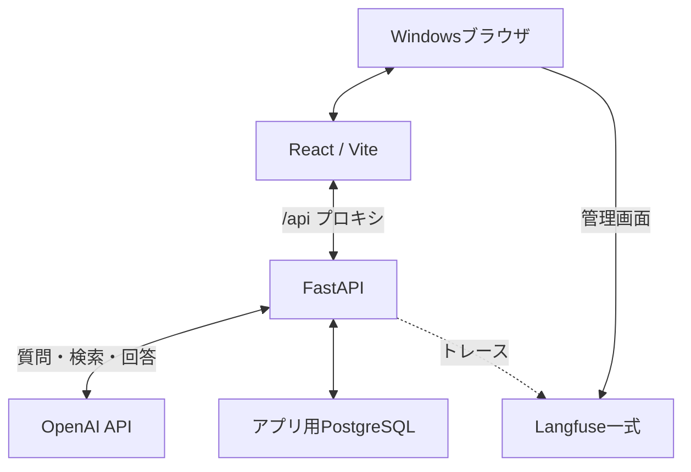

# OpenAI API 技術検証Webアプリ 仕様書

- バージョン：1.0（構成・基本設計案）
- 作成日：2026-10-12
- 更新日：2026-10-18（資料Q&A 段階1〜3（PDF登録・抽出・レビュー・根拠ハイライト）を追加）
- ステータス：初期実装済み。詳細設計の未確定事項あり。
- プロジェクト名：openai-query-app

## 1. 目的

ChatGPTのようなチャットUIからOpenAI APIを利用し、会話を続けながら、会話ごとの応答速度・トークン使用量・エラーを細かく把握できるアプリを開発する。

メッセージと過去の会話の文脈をFastAPI経由でOpenAI APIへ渡し、React／TypeScriptで回答を表示する。Web検索と任意の検索先URL指定は、チャット機能に付随する機能とする。

個人利用の技術検証として、各応答と会話全体の両方を観測する。Langfuseをセルフホストし、会話履歴、API呼び出し条件、処理時間、トークン使用量、エラーを関連付ける。ChatGPT製品の全機能の再現は目的としない。

### 1.1 用語と観測単位

| 用語 | 定義 |
| --- | --- |
| 会話 | 新規チャットから始まる一連のメッセージ。conversation_idで識別 |
| ターン | 1件のユーザーメッセージと対応する応答 |
| 実行 | 回答生成の1回の試行。失敗・再実行を含めrequest_idで識別 |
| API呼び出し | 実行内のOpenAI呼び出し。再試行は個別に記録 |

「会話ごとの観測」は、各ターンの詳細と会話全体の集計の両方を指す。

## 2. 前提・対象範囲

| 項目 | 内容 |
| --- | --- |
| 利用者 | 当面は本人1名 |
| 初期実行環境 | WindowsローカルPC＋Docker Desktop |
| PC仕様 | Ryzen 7 5825U／RAM 16GB／SSD空き約190GB |
| 将来の配置先 | Ubuntu Server。初期段階では移行作業を含めない |
| LLM実行場所 | OpenAI API。ローカルLLM・GPU推論は行わない |
| 回答形式 | 文章中心。Markdownの文章・表を表示 |
| 質問の単位 | 複数ターンの会話。過去の文脈を次の質問へ引き継ぐ |
| 同時実行 | 初期版は1件 |
| アクセス範囲 | ローカルPCのみ。公開ポートは127.0.0.1へバインド |
| アプリ認証 | メールアドレス＋パスワード（§12.1）。外部公開時はCloudflare Accessを併用 |
| Langfuse認証 | 自身のアカウントで利用 |

### 2.1 初期版に含める機能

- ChatGPTのような会話一覧、メッセージ表示、入力欄。
- 新規会話の作成と過去の会話の再開。
- 質問入力、任意URL入力、Web検索ON／OFF。
- OpenAI APIによる検索・回答生成。
- 回答、引用リンク、主要な計測値の表示。
- 成功・失敗を含む実行履歴の保存と閲覧。
- 過去の条件を使った再実行。
- Langfuseへのトレース送信と履歴からのリンク。
- 再起動後も保持されるデータ保存。

### 2.2 初期版の対象外

- 複数ユーザー、権限管理、インターネット公開。
- ストリーミング表示（初期版は回答完了後の一括表示）。
- 過去メッセージ編集による会話分岐、複数回答候補の切替。
- 特定ページの本文取得専用機能、独自クローラー、サイトのログイン操作。
- リアルタイム株価フィード、正確な金融数値の専用データ連携。
- RAG、ベクトルDB、LangGraphなどのエージェント制御基盤。
- 本番向け高可用性、水平スケール、ジョブキュー。

## 3. 採用技術と役割

| 技術 | 役割 |
| --- | --- |
| React＋TypeScript | 入力、回答、履歴、計測値の画面 |
| Vite | フロント開発サーバーとビルド |
| shadcn/ui | フォーム、ボタン、カード、タブなどのUI部品 |
| FastAPI＋Pydantic | Web API、入力検証、OpenAI呼び出し、応答整形 |
| Uvicorn | FastAPIの実行 |
| OpenAI Responses API＋Web検索ツール | 回答生成と任意のWeb検索 |
| PostgreSQL | アプリの質問・回答・主要計測値の保存 |
| Langfuse | LLM呼び出し、処理時間、使用量、エラーの観測 |
| Microsoft Presidio Analyzer | 送信前の機密情報（秘密鍵・トークン等）の検知 |
| Docker Desktop＋Docker Compose | ローカルでのLinuxコンテナ実行 |
| Nginx | 将来Ubuntuへ配置する際の静的配信とAPIへの転送 |

Langfuseは実行記録の観測基盤とし、OpenAI呼び出しの制御はFastAPI内で実装する。shadcn/uiはフロント全体のフレームワークではなく、取り込んでカスタマイズするUI部品群として使用する。

### 3.1 採用バージョン（2026-10-12 時点で固定）

| 対象 | バージョン |
| --- | --- |
| Python／Node.js | 3.13／24 |
| FastAPI／Uvicorn／SQLAlchemy／Alembic | 0.143.0／0.54.0／2.1.4／1.20.0 |
| OpenAI Python SDK | 3.29.0 |
| Langfuse Python SDK／Langfuseサーバー | 4.17.0／4.56.0 |
| React／Vite／TypeScript／Tailwind CSS | 19.2／8.3／6.0／4.3 |
| PostgreSQL（アプリ用・Langfuse用） | 17 |
| 既定モデル | gpt-5.5（環境変数 `OPENAI_MODEL` で変更可） |

Python依存は `backend/uv.lock`、フロント依存は `frontend/package-lock.json` で固定する。

## 4. システム構成



### 4.1 ローカル実行方式

- Docker DesktopでLinuxコンテナを実行する。Docker Desktop内部のWSL2環境以外に、Ubuntu等のWSLディストリビューションは使用しない。
- ソースコードはWindows側（`C:\works\openai-query-app`）に置き、WindowsのVS Codeから編集する。
- ソースはコンテナへバインドマウントする。Windowsのバインドマウントではファイル変更通知が届かないため、Vite・Uvicornともポーリングで変更を検知する。
- `node_modules` とPython仮想環境はnamed volumeに置き、Windows側のファイルI/Oを避ける。
- 改行コードは `.gitattributes` でLFに統一する。
- アプリ一式とLangfuse一式は、別のDocker Composeプロジェクトとして管理する。
- アプリ側はフロント開発サーバー、FastAPI、アプリ用PostgreSQLで構成する。
- 開発時のFastAPIは1ワーカーを基本とし、自動リロードを使用する。
- Viteからの `/api` リクエストをFastAPIへ転送する。
- コンテナ間接続にはサービス名などの内部アドレスを使い、ブラウザ用のlocalhost URLと区別する。アプリからLangfuseへの送信は `host.docker.internal` 経由とする。

| 用途 | ブラウザからの接続先例 |
| --- | --- |
| アプリ | http://localhost:5173 |
| FastAPI／APIドキュメント | http://localhost:8000 ／ http://localhost:8000/docs |
| Langfuse | http://localhost:3000 |

ポートは初期案であり、既存サービスと競合する場合は変更する。DBなどの内部サービスは原則としてホストへ公開しない。

### 4.2 Langfuseセルフホスト

公式Docker Composeをベースに、Web／Worker、PostgreSQL、ClickHouse、Redis、MinIOを構成する。ホストへ公開するのはWeb（3000）とMinIO API（9090）のみで、いずれも127.0.0.1にバインドする。初回起動時に `LANGFUSE_INIT_*` で組織・プロジェクト・ユーザー・APIキーを自動作成する。

Langfuse用のデータとアプリ履歴は分離する。アプリからLangfuse内部DBを直接参照せず、SDK等の公開インターフェースで記録する。Langfuseの管理画面URLと内部送信先URLは環境変数で管理する。

Langfuse v4はevents_onlyモードで動作し、`/api/public/traces` は利用できない。トレースの反映確認には `/api/public/v2/observations?traceId=...` を使用する。

## 5. クエリ・検索仕様

### 5.1 入力項目

| 項目 | 必須 | 内容 |
| --- | --- | --- |
| プロンプト | 必須 | 複数行テキスト。空白のみは不可 |
| Web検索 | 必須設定 | ON／OFF。初期値はON |
| 検索先URL | 任意 | Web検索ONのときに入力可能。初期版は1件 |
| モデル | 任意 | `OPENAI_MODELS` の候補から選択。未指定時は `OPENAI_MODEL` |
| モード | 任意 | 回答スタイル（§5.5）。未指定時は標準 |

### 5.2 動作の組合せ

| Web検索 | URL | 動作 |
| --- | --- | --- |
| OFF | なし | Web検索ツールを使わず回答 |
| ON | なし | ドメインを制限せずWeb検索 |
| ON | あり | 入力URLから抽出したドメインに検索対象を制限 |

検索OFF時はURL欄を無効化し、APIへはURLを送らない。検索OFFでURLを含むリクエストを直接受けた場合は、入力検証エラー（422）とする。

### 5.3 URLの意味

URLは「検索対象サイト」の指定であり、「そのページだけを必ず取得する」指定ではない。

例：`https://finance.yahoo.co.jp/` を入力した場合、ドメイン `finance.yahoo.co.jp` を検索条件に設定する。OpenAI Web検索の `filters.allowed_domains` に渡す際はスキームを含めない。ドメイン制限にはサブドメインも含まれる。

- URLの形式をFastAPIで検証し、元URLと正規化した検索ドメインを保存する。http／https以外、IPアドレス、localhost等のローカルホストは拒否する。
- パス・クエリ・フラグメントは検索範囲の厳密な制約にはならない。画面で実際の検索対象ドメインを表示する。
- プロンプト内の指示だけで検索先を制限せず、APIの検索設定を使用する。
- 初期版のURLは公開Webサイトを対象とし、サーバー自身による任意URLへの直接アクセスは実装しない。
- サイト全体の網羅検索、ページの閲覧成功、情報の即時性を保証しない。
- 必要な情報が取得できない場合は、その旨を回答・結果状態に反映する。

Web検索ONでは `tool_choice: "required"` で検索の実行を求める。実際にツールが実行されたかは応答の `web_search_call` で確認する。未実行の場合は「検索済み」と表示せず、結果区分を `search_not_executed` とする。参照元一覧の取得には `include: ["web_search_call.action.sources"]` を使用する。

### 5.4 会話の文脈管理

- アプリDBを正本とし、会話IDに紐付くメッセージを時系列で保存する。
- バックエンドがシステム指示、過去の確定したユーザー／アシスタントメッセージ、今回の入力からAPI入力を構成する。OpenAI側の会話保存（`store`、`previous_response_id`）は使用しない。
- 新規会話は過去の別会話の文脈を引き継がない。再開した会話はその会話だけを参照する。
- Web検索設定とURLは送信ごとに記録する。画面で前回の設定を引き継いでも、実行条件を個別に保持する。
- 今回のドメイン制限は今回の検索に適用する。過去の会話に含まれる別の出典由来の回答まで置き換えるものではない。
- 失敗試行、部分応答、同じ質問の再試行を次の文脈へ重複追加しない。成功回答のないターンは文脈に含めない。
- 初期版の再実行は直近ターンに限定する。同じ文脈で新しい実行を作り、過去の試行を保存する。次の質問には当該ターンの最新の成功回答1件を使用する。
- 各実行に、文脈のメッセージID／順序、送信内容のスナップショット、設定を紐付ける。
- 文脈上限を超える場合は明示的に通知する。初期版では無通知の切り捨てや自動要約を行わない。初期版の判定は、システム指示・文脈・今回の入力の文字数合計と `MAX_CONTEXT_CHARS` の比較とする。APIが `context_length_exceeded` を返した場合も同じエラー区分で通知する。

### 5.5 システム指示と回答スタイルのモード

システム指示は `backend/prompts/` のファイルで管理し、Gitで変更履歴を残す。ファイルは実行ごとに読み直し、再起動せずに反映する。

- `base.md` は全モード共通の基本ルールとする。
- `modes/<id>.md` は各モードの追加指示とする。送信する指示は「base.md＋モードの本文」とする。
- モードはファイルの先頭に表示名・説明・表示順と、任意のAPIパラメータ（`verbosity`、`reasoning_effort`）を持つ。
- APIパラメータは対応モデル（gpt-5系）にだけ付ける。gpt-4.1系は非対応（400エラー）のため指示文だけを適用する（2026-10-12確認）。
- 指示文とAPIパラメータのハッシュを `prompt_version` とし、実行ごとにモードと合わせて記録する。

| モード | 内容 | APIパラメータ |
| --- | --- | --- |
| 標準 | 基本ルールのみ。モード導入前と同じ指示 | なし |
| トークン節約 | 結論と最小限の根拠だけを、簡略化した日本語で書く | verbosity・reasoning_effortともlow |
| ビジネス | 丁寧なビジネス文体。結論→根拠→補足の順。曖昧表現を避ける | なし |
| やさしく説明 | 中学生にもわかる言葉。たとえを入れ、順を追って説明する | なし |

モードは送信ごとに選ぶ。会話の途中で切り替えてもよく、過去の回答は元のモードのまま文脈に含める。再実行はモードを指定でき、指定しない場合は再実行元と同じモードとする。

2026-10-12の実測（gpt-5.6-luna、検索OFF、同じ質問）では、トークン節約の出力は標準の約4割（249→101トークン）だった。検索ONでは入力の大半が検索結果であり、料金の大半は検索の呼び出し料金のため、節約効果は小さくなる。

## 6. 処理フロー

1. Reactで入力を受け付け、送信中は重複操作を抑止する。
2. FastAPIで会話IDと入力を検証し、ターンID・実行IDを発行する。
3. 会話履歴からAPI入力を構成し、入力メッセージ、文脈スナップショット、実行条件をアプリDBに保存して処理中とする。
4. Langfuseのトレースを開始し、会話ID・ターンID・実行IDと紐付ける。
5. OpenAI Responses APIへ会話の文脈、今回の質問、検索設定を送る。
6. 応答から本文、引用、使用量、検索実行情報を取り出す。
7. 結果・主要計測値・エラー情報をアプリDBへ保存する。
8. アプリ用JSONをReactへ返す。
9. Reactが回答、引用リンク、計測値を描画する。
10. Reactが画面上の待ち時間を確定し、別リクエストで追記する。

初期版はHTTPリクエストの完了時にまとめて返す方式とする。バックエンドは非同期I/Oを使用できるが、ジョブキュー方式にはしない。1件の実行制限は画面だけでなくバックエンドでも制御する。バックエンドはプロセス内ロックで制御し、処理中に別の実行要求を受けた場合は409を返す。

## 7. 画面仕様

### 7.1 チャット画面

- 左側に会話一覧と「新規チャット」、中央に時系列のメッセージ、下部に入力欄を配置する。
- 左の会話一覧と、上部の計測値の欄は折りたためる。開閉の状態は閲覧者のブラウザに保存する。
- 各回答の左にキャラクターのアイコンと名前、チャット欄の右に立ち絵を表示する（画面幅1280px以上）。名前と画像は `backend/character/` で設定し、見た目だけでモデルへの指示には含めない。ヘッダーのスイッチで表示をOFFにでき、OFFのときは顔を出さず名前を「AI」とする（閲覧者のブラウザに保存）。
- 会話一覧から過去の会話を選択し、続きの質問を送信できる。
- 入力欄でモデルを選択する。会話を開くと、その会話で最後に使ったモデルを選択状態にする。再実行も選択中のモデルで行う。
- 入力欄でモードを選択する。選択状態の扱いはモデルと同じとする。各回答の下に実行したモードを表示する。
- 「モード別の実績」で、モード×モデル×検索有無ごとに、成功した実行の平均出力トークン・推論トークン・回答文字数・推定料金・API所要時間を表示する。
- 会話一覧とヘッダーに、その会話で使ったモデルを表示する。各回答の下には実行したモデルを表示する。
- 会話一覧から会話を削除できる。削除は一覧からの非表示であり、DBのデータは残す。
- プロンプト入力、Web検索切替、任意URL入力、送信ボタン。
- 各回答の下に応答時間、入力／出力トークンの概要を表示する。
- 「計測詳細」で処理時間の内訳、使用量、文脈情報、エラー、Langfuseリンクを確認する。
- 会話全体の累計トークン、実行回数、平均応答時間を確認できる集計領域を設ける。
- 待機中／処理中／完了／エラーを表示。
- 回答本文をMarkdownとして表示し、生HTMLは実行しない。
- 回答内の引用を明確なクリック可能リンクとして表示し、参照元一覧も表示する。
- 実際の検索先、モデル、回答生成日時、待ち時間、API所要時間、トークン使用量を表示する。
- エラー時は内容と再実行手段を示す。内部スタックトレースをそのまま画面へ出さない。

### 7.2 履歴一覧・詳細画面

- 会話タイトル、更新日時、メッセージ数、累計トークンを一覧表示する。タイトルは初回入力から作成し、タイトル生成専用のLLM呼び出しは初期版では行わない。
- 会話詳細で各ターン・実行日時・成功／失敗・主要計測値を確認する。
- 詳細に入力全文、検索条件、回答、引用、実行条件、計測値を表示する。
- 直近ターンの再実行では新しい実行IDを発行し、過去の試行結果を上書きしない。過去の試行は画面で切り替えて閲覧できる。
- Langfuseの該当トレースへ遷移できるリンクを表示する。トレース未送信・未反映は区別する。
- 一覧はページ分割する。初期版の表示件数は30件。

### 7.3 Langfuse管理画面

呼び出しごとの処理内訳、プロンプト、応答、使用量、エラーを確認する。独自画面にLangfuse全機能を再実装しない。

## 8. 観測仕様

### 8.1 時間指標

| 指標 | 計測範囲 | 計測場所 |
| --- | --- | --- |
| 画面上の待ち時間 | 送信開始から結果の描画完了まで | React |
| バックエンド処理時間 | FastAPI受付から結果のDB保存完了まで | FastAPI |
| OpenAI API所要時間 | API呼び出し開始から最終応答受信まで | FastAPI／Langfuse |
| DB保存時間 | 各履歴保存処理の開始から完了までの合計 | FastAPI |
| 最初の文字が届くまでの時間 | 送信開始から最初の回答テキスト受信まで | 将来のストリーミング対応時 |

時間はミリ秒単位で保持する。期間計測には単調増加時計を使用し、日時とは分ける。OpenAI API所要時間にはネットワークや待ち時間が含まれ、モデル内部の純粋な計算時間を示すものではない。

バックエンド処理時間は、結果保存のcommit完了までを含む。計測値自体の追記とレスポンスのシリアライズは含まない。各処理時間は重なる場合があるため、単純合計と画面待ち時間が一致することを要求しない。

画面待ち時間は、結果を描画した後の次のペイントまでを計測する。サーバー応答後に確定するため、`PATCH /api/v1/runs/{id}/client-metrics` で追記する。最初の値のみ採用する。画面が閉じられた場合など、未取得の値はnullとする。

### 8.2 使用量・条件

| 分類 | 記録内容 |
| --- | --- |
| 基本使用量 | 入力、出力、合計トークン |
| 追加使用量 | APIが返す場合、キャッシュ済み入力・推論トークン |
| 実行条件 | モデル名、モード、検索ON／OFF、検索先、システム指示の版（prompt_version）、モードのAPIパラメータ |
| 識別情報 | 会話ID、ターンID、実行ID、API呼び出しID、OpenAI応答ID、LangfuseトレースID |
| 検索情報 | 検索ツール実行の有無、取得可能なツール呼び出し情報 |

使用量はAPIの返却値を保存し、未取得をゼロとして扱わない。内訳トークンを合計へ重複加算しない。推定料金は、API呼び出しごとのトークン料金（キャッシュ済み入力・長文脈単価を区別）と、Web検索の呼び出し料金（1回$0.01）の合計とする。モデル別単価は `pricing.py` に定義し、単価未定義のモデルはnull（不明）とする。推定料金は利用上限の判定と画面表示に使う目安であり、請求額との一致は保証しない。

### 8.3 会話全体の集計とトークンの解釈

- 各ターンには実行別の計測値を表示し、会話全体には実行回数、成功・失敗件数、入力／出力／合計トークンの累計を表示する。
- 平均応答時間は成功した実行の画面待ち時間のうち取得済みの値を対象にし、対象件数も表示する。API所要時間の平均は別項目として扱う。
- 処理時間の累計と、ユーザーが考えていた時間を含む会話の経過時間を区別する。
- トークン累計はAPI呼び出しの返却値を合計する。再試行・再実行や、失敗時でも使用量が得られた呼び出しを含め、二重計上しない。
- 使用量不明の呼び出しがある場合は「取得済み分の合計」と表示し、不明件数を示す。
- 入力トークンは今回の質問だけではなく、送信したシステム指示や過去の文脈などを含むAPI返却値として扱う。画面の文字数の合計で代用しない。
- 今回の質問と過去の文脈のトークン内訳は、APIが分離して返さない場合に実測値として表示しない。将来ローカルで推定する場合は「推定」と明記する。
- Langfuseでは会話IDを `session_id` とし、実行単位のトレース（ルートspan `chat-run`）とAPI呼び出し単位のgeneration（`openai.responses.create`）を関連付ける。トレースIDは実行IDをシードに決定的に生成する。
- 初期版は非ストリーミングのため、TTFT（最初の回答テキストが届くまでの時間）と純粋な生成速度は測定対象外。出力トークン数をAPI総所要時間で割った値をモデルの生成速度と同一視しない。

### 8.4 エラー・障害

- 入力不備、タイムアウト、API利用制限、認証・設定不備、外部API障害、DB保存失敗、Langfuse記録失敗を識別する。
- 情報不足や検索結果なしは、通信障害とは別の結果状態として扱う。
- Langfuse送信は非同期・ベストエフォートとし、記録失敗のみを理由に回答返却を失敗させない。
- DB障害時は「履歴保存済み」と表示しない。DBへ書けない場合の診断情報はアプリログへ残す。
- アプリ再起動で処理中のまま残った実行を検出し、中断状態として整理する。
- タイムアウト・上限値は設定可能とする。自動再試行は既定で行わない。`OPENAI_MAX_RETRIES` を設定した場合のみ、429（利用枠不足を除く）・5xx・接続エラー・タイムアウトを対象に再試行する。

| エラー区分 | 内容 |
| --- | --- |
| validation_error／invalid_search_url／prompt_too_long | 入力不備 |
| context_limit_exceeded | 文脈上限超過 |
| timeout／network_error | タイムアウト・通信エラー |
| rate_limited／quota_exceeded | API利用制限・利用枠不足 |
| auth_error／config_error | 認証・設定不備 |
| bad_request／upstream_error | リクエスト不正・OpenAI側障害 |
| db_error | DB保存失敗 |
| busy | 同時実行上限 |
| usage_limit_exceeded | 利用上限（1日の実行回数、1日・1か月の推定利用額）超過。HTTP 429 |
| interrupted | 再起動による中断 |

## 9. データ設計案

会話、ターン、メッセージ、実行、API呼び出しを関連付けて管理する。引用・追加メトリクス・文脈スナップショットはJSONBで保持する。

| エンティティ | 主な内容 |
| --- | --- |
| users | 利用者ID、メールアドレス、パスワードハッシュ（Argon2）、最終ログイン、連続失敗回数、ロック解除日時 |
| auth_sessions | トークンのSHA-256、利用者ID、作成・最終利用・有効期限日時、User-Agent |
| secret_detections | 検知日時、会話ID、送信元（送信／再実行）、検知した種類・位置・確からしさ、プロンプトの文字数。値そのものは保存しない |
| conversations | 会話ID、タイトル、作成・更新日時、非表示日時（hidden_at） |
| turns | ターンID、会話ID、順序、入力メッセージ、採用する成功回答 |
| messages | メッセージID、会話ID、ターンID、role、本文、引用、生成元実行ID |
| runs | 実行ID、会話ID、ターンID、再実行元ID、状態、条件、文脈、計測値 |
| api_calls | 呼び出しID、実行ID、試行番号、モデル、使用量、API所要時間、エラー |

turns→messages、messages→runs の外部キーは循環参照になるため、DEFERRABLE INITIALLY DEFERREDとする。

以下は実行に紐付ける主な項目。呼び出し明細から集計する項目と、実行自身の計測値を区別する。

| 項目群 | 主な項目 |
| --- | --- |
| 識別 | id、conversation_id、turn_id、retry_of_run_id |
| 入力 | prompt、web_search_enabled、search_url、searched_domain |
| 実行条件 | model、mode、prompt_version、settings、context_message_ids、request_snapshot |
| 出力 | answer、citations、search_info |
| 状態 | status（running／succeeded／failed／interrupted）、outcome（answered／search_not_executed／incomplete:理由） |
| 時刻 | created_at、started_at、completed_at |
| 時間 | backend_duration_ms、openai_duration_ms、db_duration_ms、client_duration_ms |
| 使用量 | input_tokens、output_tokens、total_tokens、cached_input_tokens、reasoning_tokens、estimated_cost_usd |
| エラー | error_code、機密情報を除いたerror_message |
| 外部識別 | openai_response_id、langfuse_trace_id、langfuse_status |

日時はUTCで保存し、画面では日本時間を基本に表示する。未取得の計測値はnullとする。引用はURL・タイトル・本文内の引用位置を保持し、本文変換時に引用位置がずれないように扱う。

アプリDBとLangfuseは役割の異なる保存先である。質問・回答の正本はアプリDBとし、Langfuseの保存期間や障害に依存せず履歴を閲覧できるようにする。

## 10. Web API設計案

| メソッド | パス | 用途 |
| --- | --- | --- |
| GET | /api/v1/models | 選択可能なモデルと既定モデル |
| GET | /api/v1/usage | 当日・当月の実行回数と推定利用額、上限値 |
| GET | /api/v1/modes | 選択可能なモードと既定モード |
| GET | /api/v1/stats/modes | モード×モデル×検索有無ごとの実績（成功した実行の平均） |
| POST | /api/v1/conversations | 新規会話作成 |
| GET | /api/v1/conversations | 会話一覧と集計、使用モデル |
| GET | /api/v1/conversations/{id} | 会話詳細、メッセージ、計測概要、使用モデル |
| DELETE | /api/v1/conversations/{id} | 会話の非表示（データは削除しない） |
| POST | /api/v1/conversations/{id}/messages | メッセージ送信、回答生成、保存 |
| POST | /api/v1/turns/{id}/retry | 直近ターンの再実行（`model` 指定可、未指定時は再実行元と同じ） |
| GET | /api/v1/runs/{id} | 実行詳細とAPI呼び出し別の計測値 |
| PATCH | /api/v1/runs/{id}/client-metrics | 画面待ち時間の追記 |
| GET | /api/v1/runs/{id}/langfuse | トレースの送信状態とLangfuseへの反映有無 |
| GET | /api/health | アプリ稼働確認（ログイン不要） |
| POST | /api/v1/auth/login | ログイン（ログイン不要） |
| POST | /api/v1/auth/logout | ログアウト |
| GET | /api/v1/auth/me | ログイン中の利用者 |
| GET | /api/v1/character | キャラクターの名前と画像URL |
| GET | /api/v1/character/{avatar,portrait} | キャラクター画像 |

非表示にした会話は、一覧・詳細・送信・再実行のいずれでも404とする。候補外のモデルを指定した場合は422（`invalid_model`）、存在しないモードを指定した場合は422（`invalid_mode`）とする。

会話IDをパスで指定し、バックエンドでその会話の文脈を読み込む。再実行は新しい実行を作成し、ターンと再実行元に関連付ける。

実行を記録できた場合は、OpenAI呼び出しが失敗しても200で `status: "failed"` と `error` を返す。実行を作成する前の失敗は、エラーに応じて404／409／422／503で `{"detail": {"code", "message"}}` を返す。

### 10.1 リクエスト例

```json
{
  "prompt": "トヨタ自動車に関する最近のニュースを要約してください",
  "web_search_enabled": true,
  "search_url": "https://finance.yahoo.co.jp/",
  "model": "gpt-5.5",
  "mode": "business"
}
```

URL未指定時は省略またはnullとする。Web検索OFFでも質問実行を可能とする。

### 10.2 レスポンス項目

`conversation_id`、`turn_id`、`message_id`、`request_id`、`status`、`outcome`、`persisted`、`answer`、`citations`、`searched_domain`、`search_info`、`generated_at`、`model`、`usage`、`timings`、`error`、`langfuse_trace_id`、`langfuse_url`等を返す。

これはFastAPIが組み立てるJSONであり、回答全体をLLMにJSON形式で生成させる必要はない。厳密なスキーマは `/docs`（OpenAPI）を正とする。

## 11. 資源・運用方針

| 項目 | 初期方針 |
| --- | --- |
| WSLメモリ | `.wslconfig` で全体上限8GB（Docker Desktopの実行環境に適用）。実測で調整 |
| FastAPI | 1ワーカー、同時質問1件 |
| 永続化 | アプリDBとLangfuse関連ストレージを永続ボリュームへ保存 |
| ログ | Dockerログのローテーションを設定（10MB×3） |
| 保持期間 | アプリDBとLangfuseのトレースは無期限。ClickHouse自身の動作ログ（system.*_log）は7日（§11.1） |
| 停止・再起動 | 通常操作では永続ボリュームを削除しない |
| バックアップ | アプリDB・Langfuse Postgres・.env類を毎日暗号化してR2へ保存、30世代保持（§11.2）。永続ボリューム自体はバックアップではない |

RAM 16GBはWindows、ブラウザ、VS Code、Docker Desktop、全コンテナで共有される。Langfuse公式のVM向け目安は4コア・16GiBメモリ以上であり、本PCでの快適動作を保証するものではない。8GBは動作保証値でもLangfuse専用割当でもない。

起動時・アイドル時・質問実行時のメモリとディスクを測定する。OOMや継続的なスワップによる遅延が発生する場合は構成・割当を見直し、必要に応じてLangfuseのみ別ホストへ移せるようにする。

### 11.1 保存期間

2026-10-12の実測では、1実行あたりアプリDBが約12KB、Langfuseのトレースが約6KBである。1日100回（上限）でも年に約0.7GBで、保存先のディスクに対して小さい。一方、ClickHouse自身の動作ログは実行回数と無関係に約75MB/日（年約27GB）増える。

| 対象 | 保存期間 | 理由 |
| --- | --- | --- |
| アプリDB | 無期限。自動削除しない。非表示の会話も残す | 質問・回答の正本。データ量が小さい |
| Langfuseのトレース | 当面無期限。1年後またはディスク使用量1GB超で見直す | セルフホストOSS版には保持期間の設定機能がない（Enterprise版のみ）。必要になればLangfuse APIで古いトレースを削除する |
| ClickHouseの動作ログ | 7日 | 放置すると年27GB程度増える。障害調査に必要なのは直近数日分 |
| Dockerログ | 10MB×3 | 既存設定 |

ClickHouseの動作ログのうち、既定設定で `engine` を指定している asynchronous_insert_log・processors_profile_log・opentelemetry_span_log はTTLを設定できないため対象外とする。いずれも小さい。

### 11.2 バックアップ

| 対象 | 方法 | 頻度・保持 |
| --- | --- | --- |
| アプリDB | pg_dump（custom形式）→ age暗号化 → Cloudflare R2 | 毎日、30世代 |
| Langfuse Postgres | 同上 | 毎日、30世代 |
| .env・langfuse/.env | tarにまとめて同じ世代に含める | 毎日、30世代 |
| ClickHouse（トレース本体） | 対象外 | — |

- R2はkaikeiと同じバケットを使い、`openai-query-app/<UTC時刻>/` に保存する。世代の削除はこのプレフィックス配下だけを対象にし、バケットのライフサイクル設定は変更しない。
- age公開鍵はkaikeiと共通とする。復号鍵はサーバーに置かない。
- Langfuse PostgresはLangfuseの `ENCRYPTION_KEY` がないと復元しても使えない。そのため.env類を同じ世代に含める。
- ClickHouseはバックアップしない。計測値の正本はアプリDBであり、失ってもLangfuse上の過去トレースが見えなくなるだけである。
- 成功時にHealthchecks.ioへ通知し、途絶えたら通知を受ける。日次の自動実行と監視登録はt430-server移行時に設定する。
- 復元テストは導入時に1回（2026-10-12実施済み）、以後3か月ごとに `scripts/restore_check.sh` で行う。本番DBには触れず、一時DBへ復元して件数を確認する。

## 12. 設定・セキュリティ

- OpenAI APIキーとLangfuseの認証情報はバックエンド側の環境変数で管理し、フロントへ埋め込まない。
- シークレットをGitやログへ保存しない。`.env` は `scripts/init_env.py` で生成し、Git管理外とする。
- モデル名、各サービスURL、タイムアウト、入力長、出力上限を設定項目とする。
- 上限値は次のとおりとする（v0.5で確定、いずれも環境変数で変更可）。

| 項目 | 値 | 根拠 |
| --- | --- | --- |
| 入力長 `MAX_PROMPT_CHARS` | 20,000字 | 長文の貼り付けを許容。1回の費用は小さい |
| 文脈上限 `MAX_CONTEXT_CHARS` | 60,000字 | 毎回全文脈を再送するため、1回の費用を抑える（gpt-5.5で最大約$0.3） |
| 出力上限 `MAX_OUTPUT_TOKENS` | 8,000 | 推論トークンを含む。実測最大1,256の約6倍 |
| タイムアウト `OPENAI_TIMEOUT_SECONDS` | 90秒 | Cloudflare Tunnelの100秒制限より短くする。実測最大18秒 |
| 自動再試行 `OPENAI_MAX_RETRIES` | 0 | 重複課金を避ける |
| 1日の実行回数 `DAILY_RUN_LIMIT` | 100回 | 失敗を含むすべての実行を数える |
| 1日／1か月の推定利用額 | $3／$30 | モデル間で単価が最大25倍異なるため、回数ではなく金額で制限する |

- 利用上限は実行前に判定する。上限到達後の実行は429で拒否し、実行を作成しない。直前の1回で上限をわずかに超えることは許容する。
- 1日・1か月の区切りは `USAGE_TIMEZONE`（既定はAsia/Tokyo）とする。
- OpenAI管理画面のプロジェクト予算アラートを最終的な安全策として併用する。
- 外部ページ本文をアプリ側の命令として扱わず、検索先設定などの制御を変更させない。
- 回答内リンクはHTTP／HTTPS等の許可スキームに制限し、Markdownの生HTMLは無効にする。
- ローカル限定でもバックエンドで入力検証する。
- ネットワーク公開時は、HTTPS（`COOKIE_SECURE=true`）とCloudflare Accessによるアクセス制御を併用する。

### 12.1 ログイン

利用者は本人1名とする。会話データは利用者ごとに分けない。

- アカウントは `python -m app.cli` で作成・変更する。画面からの新規登録とパスワード再設定は設けない。
- パスワードは12文字以上とし、Argon2のハッシュだけを保存する。
- ログイン状態はランダムなトークンをCookie（HttpOnly、SameSite=Lax）で保持する。DBにはトークンのSHA-256だけを保存する。
- 最後に使ってから30日（`SESSION_DAYS`）で無効にする。利用のたびに期限を延ばし、Cookieの期限も合わせて更新する。
- 連続5回の失敗で15分ロックする。パスワード違いと未登録のメールアドレスは同じ応答とし、処理時間もそろえる。
- ヘルスチェックとログイン以外のAPIはログイン必須（未ログインは401）とする。
- 更新系リクエストはヘッダー `X-OQA-Request: 1` を必須とする（未付与は403）。他サイトのページからはCORSの事前確認なしに付けられないため、CSRF対策になる。
- パスワード変更時は、その利用者のログイン状態をすべて無効にする。

| エラー区分 | 内容 |
| --- | --- |
| unauthenticated | 未ログイン・期限切れ（401） |
| invalid_credentials | メールアドレスまたはパスワードが違う（401） |
| login_locked | 連続失敗によるロック中（429） |
| forbidden | 必須ヘッダーのない更新系リクエスト（403） |

### 12.2 送信前の機密情報検知

プロンプトをOpenAIへ送る前に、Microsoft Presidio Analyzer（Dockerコンテナ、2.2.362）で機密情報を検知し、検知したら送信をブロックする。個人情報の検知は行わない。

- Presidio標準の認識器（PII向け）は使わない。アプリで定義した正規表現の認識器をリクエストごとに `ad_hoc_recognizers` として渡し、`entities` をそれらに限定する。大文字小文字は区別する。
- 対象は、秘密鍵（SSH・TLS・PGP・PuTTY・age）、クラウド・SaaSのアクセスキーとトークン（AWS・GitHub・GitLab・Stripe・Google・Slack・Brevo・npm・Hugging Face・PyPI・DigitalOcean・SendGrid・Shopify・Telegram）、Google OAuthクライアントシークレット、`sk-` 形式のAPIキー、JWT、パスワード付き接続文字列、パスワード等の代入、接頭辞のないランダムなトークンとする。
- 接頭辞のないランダムなトークンは、Presidioで候補（英数字・記号が20文字以上続く部分）を抽出し、アプリ側で判定する。判定には、文字の散らばり（エントロピー）、文字種の混ざり方、英単語らしさ（同じ大文字小文字の英字が5文字以上続く割合）、数字の割合を使う。
  - 英大文字・小文字・数字が混ざるものは文脈なしで検知する。
  - 16進数や小文字＋数字だけのものは、直前40文字に key・token・password・キー・トークン等の語があるときだけ検知する。コミットハッシュやチェックサムと区別できないためである。
  - 2026-10-18の実験（架空データ）では、英数字のランダム文字列（20〜44文字）を97〜100%、語を伴う16進数・小文字＋数字のトークンを97〜100%検知した。識別子・パス・ハッシュ・UUID・バージョン番号・公開鍵など25パターンは検知しなかった。base64のデータなど、ランダムに見える長い文字列は検知されることがある。
- 代入のルールは、値が関数呼び出し・環境変数参照・`${VAR}`・`<placeholder>` のものを除外し、コードの質問での誤検知を避ける。
- 検査は履歴の保存より前に行う。ブロック時は会話・実行・Langfuseのいずれにも記録しない。再実行も検査する。
- 画面には検知した種類と伏せ字（先頭数文字と文字数）だけを表示し、入力内容は入力欄に残す。新規チャットで断られた場合は、作成した空の会話を一覧から外す。
- 検知の記録は `secret_detections` に残し、アプリログにも種類だけを出す。値そのものはどこにも保存しない。
- Presidioに接続できない場合は送信を止める（fail-closed）。`SECRET_SCAN_FAIL_OPEN=true` で検査なしの送信に切り替えられる。
- 2026-10-18の確認では、Presidio実機とアプリ内の照合結果が263サンプルすべてで一致した。架空の値38件をすべて検知し、通常の文章・コード・公開鍵・URL・識別子・個人情報など25件は検知しなかった。Presidioのメモリ使用量は起動直後約0.8GB、検査後約0.95GBだった。

| エラー区分 | 内容 |
| --- | --- |
| secret_detected | 機密情報を検知して送信をブロック（422）。検知した種類・位置・伏せ字を返す |
| secret_scan_unavailable | Presidioに接続できず送信を中止（503） |

### 12.3 資料Q&A（PDF根拠提示型RAG）

別紙「PDF根拠提示型RAGシステム 設計書」（v1.2、2026-10-18、[PDF_Evidence_RAG_System_Design.md](PDF_Evidence_RAG_System_Design.md)）を今のアプリに「資料Q&A」として組み込む。ログイン・利用上限・観測・機密情報検知は既存の仕組みを共有する。PoCの評価対象はトヨタ自動車・本田技研工業・日産自動車で、PDFは利用者が手動で登録する。

2026-10-18時点で実装したのは設計書の段階1〜3である。

| 段階 | 実装内容 |
| --- | --- |
| 1 | 企業・資料・原本版の登録（アップロードのみ。URL取得は実装しない）、SHA-256による原本固定と重複検出、メタデータ修正、公式性の確認、論理削除、監査記録 |
| 2 | ワーカー（jobsテーブル、FOR UPDATE SKIP LOCKED、lease 90秒・heartbeat 15秒、子プロセスで解析、10分で打ち切り、全ページ成功時だけ確定）、PyMuPDFによる行・文字座標・表の抽出、ページ品質判定、レビュー画面、承認と既定化 |
| 3 | PDF.jsによる原本表示と四辺形のハイライト（回転・CropBox・拡大率・高DPI対応）、HTML表示（`id="ev-{uuid}"`）、根拠IDからの表示画面 |

設計書との差分・未実装は次のとおりとする。

- 根拠の位置は `evidence_regions` テーブルではなく、要素（elements）の `quads_pdf`（複数の四辺形）に持つ。
- 表の結合セル・改ページ表の結合・行列対応の手修正（設計書6.4）は未実装。レビューは閲覧と承認のみ。
- 検索用文字列と原文の区間対応（source_map）、chunks・埋め込み・financial_facts・回答生成（段階4以降）は未実装。
- 解析プロセスの非root化・ネットワーク遮断は未実施（コンテナのメモリ上限1.5GBのみ）。
- Idempotency-Keyは未実装。同じ企業への同一PDFの重複登録はSHA-256で拒否する。

## 13. 検証・受入観点

| 検証項目 | 確認内容 |
| --- | --- |
| 基本回答 | チャットUIでプロンプトのみの入力・回答表示ができる |
| 会話継続 | 前の内容を参照する質問に文脈を引き継ぎ、新規会話には混在しない |
| 会話再開 | 再起動後に過去の会話を開いて続けられる |
| 文脈記録 | 送信したメッセージと設定を追跡できる |
| 会話集計 | 再試行を含む使用量を二重計上せず、不明値を区別する |
| 検索切替 | OFF、ON＋URLなし、ON＋URLありを実行できる |
| 検索制限 | 指定ドメインがAPI設定に反映され、検索実行と引用を確認できる |
| URLの限界 | 取得できない情報を取得済みと表示しない |
| 履歴 | 成功・失敗を保存し、再起動後も閲覧できる |
| 再実行 | 過去の回答を残したまま新しい実行として記録される |
| 使用量 | APIが返す使用量と表示値が対応し、未取得とゼロを区別する |
| 計測 | 定義した時間指標が確認できる |
| Langfuse | トレースとアプリ履歴が紐付き、詳細を開ける |
| 記録障害 | Langfuse停止時も回答処理を継続できる |
| 同時実行 | 重複クリックや複数タブでも実行上限を守る |
| エラー | タイムアウト・API制限等を区別して表示する |
| 資源 | PC上でメモリ不足の有無と実行中の資源使用量を確認する |

数値による応答時間目標は現時点では定めず、検索あり／なしの実測値を蓄積して判断する。

## 14. 将来のUbuntu移行

- Linuxコンテナ、環境変数、永続ボリュームを前提にし、Windows固有の絶対パスへ依存しない。
- Reactはビルド成果物をNginxで配信し、`/api` をFastAPIへ転送する。
- 本番配信時はVite開発サーバーを使用せず、React静的配信専用のNode.jsサーバーも不要とする。
- 開発用リロードとポーリング監視を無効化し、認証・HTTPS・公開範囲・バックアップを整える。
- アプリDBとLangfuseのデータ移行をそれぞれ計画する。
- サーバースペックはローカル検証の実測値から決める。

## 15. 未確定事項

1. ~~正式なプロジェクト名とリポジトリ名~~ → openai-query-app（v0.3で確定）。
2. ~~OpenAIの使用モデルの最終決定、モデル切替UIの要否~~ → 切替UIを実装（v0.4）。既定はgpt-5.5、候補は `OPENAI_MODELS` で設定。
3. ~~各依存ライブラリ、Langfuse、コンテナのバージョン~~ → §3.1で固定（v0.3）。
4. ~~入力長・出力長・タイムアウト・利用回数の上限~~ → §12で確定（v0.5）。
5. 再試行方針とAPIエラーの詳細スキーマ。初期版は自動再試行なし。
6. ~~履歴とトレースの保持期間、削除・バックアップ方針~~ → §11.1・§11.2で確定（v0.6）。
7. ~~Web検索ONを初期値とする案の最終確定~~ → ON（v0.3で確定）。
8. ~~画面待ち時間を履歴へ追記するAPIの詳細~~ → §8.1・§10で確定（v0.3）。
9. 会話文脈の上限値と超過判定方法。初期版は文字数ベースの簡易判定。トークン数での判定は未確定。
10. ストリーミングを追加する時期。初期版の一括表示ではTTFTは取得しない。

## 16. 参考資料

会話中に確認した公式資料。実装開始時に採用バージョンとの対応を再確認した。

- [OpenAI Web search](https://developers.openai.com/api/docs/guides/tools-web-search)
- [Langfuse Observability](https://langfuse.com/docs/observability/overview)
- [Langfuse Python SDK](https://langfuse.com/docs/observability/sdk/python/overview)
- [Langfuse Self-hosting](https://langfuse.com/self-hosting)
- [Langfuse Docker Compose](https://langfuse.com/self-hosting/deployment/docker-compose)
- [Langfuse Headless Initialization](https://langfuse.com/self-hosting/administration/headless-initialization)
- [Langfuse Public API](https://langfuse.com/docs/api-and-data-platform/features/public-api)
- [FastAPI Deployment](https://fastapi.tiangolo.com/deployment/)
- [shadcn/ui](https://ui.shadcn.com/docs)

## 17. 改訂履歴

| バージョン | 日付 | 内容 |
| --- | --- | --- |
| 0.1 | 2026-10-12 | ローカル技術検証用の構成・基本設計を作成 |
| 0.2 | 2026-10-12 | ChatGPTのようなUIからOpenAI APIを利用する目的を明確化。複数ターン会話、会話／各応答の観測、文脈保存、データ・API設計を更新 |
| 1.0 | 2026-10-18 | 資料Q&A（PDF根拠提示型RAG）の段階1〜3を追加（§12.3） |
| 0.9 | 2026-10-18 | 送信前の機密情報検知（Microsoft Presidio、§12.2）を追加 |
| 0.8 | 2026-10-18 | メールアドレス＋パスワードのログイン（§12.1）を追加。キャラクター表示と、会話一覧・計測値の折りたたみを追加 |
| 0.7 | 2026-10-12 | システム指示をbackend/prompts/のファイル管理に変更。回答スタイルのモード（標準・トークン節約・ビジネス・やさしく説明）とモード別の実績表示を追加 |
| 0.6 | 2026-10-12 | 保存期間（ClickHouse動作ログ7日、他は無期限）とバックアップ方針（R2・age・30世代）を確定。backup.sh・restore_check.shを追加 |
| 0.5 | 2026-10-12 | 入出力長・文脈・タイムアウト・利用上限を確定。推定料金の記録・表示と利用上限（429）を追加 |
| 0.4 | 2026-10-12 | 画面でのモデル切替と会話ごとの使用モデル表示、会話の削除（非表示、データは保持）を追加。モデル候補にgpt-5.6系（sol／terra／luna）を含める |
| 0.3 | 2026-10-12 | WSL Ubuntuを使わずDocker Desktopのみで実行する方式に変更。プロジェクト名・採用バージョン・Web検索既定値・画面待ち時間追記APIを確定。Langfuse v4のAPI差異、エラー区分、HTTP応答方針を追記 |
